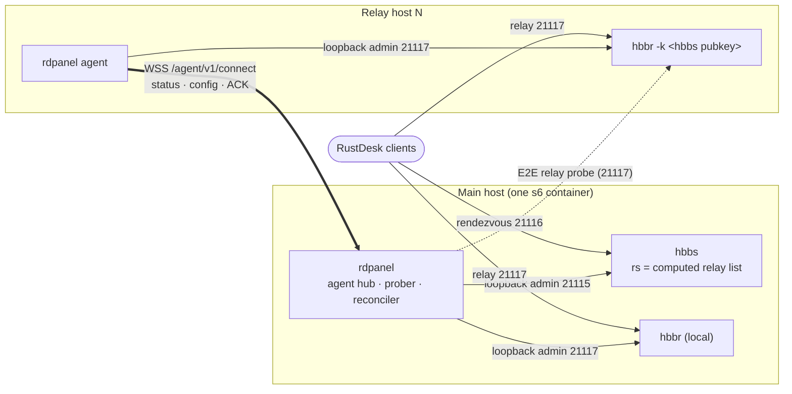

# Design: remote relay agents and panel federation

Status: **phases 0 and 1 implemented** (branch `feat/relay-agents`); phases 2-4 open. The open
questions are decided in [§16](#16-decisions-and-implementation-status), which also lists where the
implementation differs from this draft. User guide: [`../relay-agents.md`](../relay-agents.md).

Sources: this repo at `main` (`040325f`) and `rustdesk-server` at `merge-upstream-1.1.16` (`8b6f490`).
`srv:` marks paths in the server fork; unprefixed paths are in this repo. Line numbers in
`docs/research/hbbs-integration.md` refer to the older `8a2a9fc`; line numbers here refer to the current heads.

## TL;DR

- **What:** run extra hbbr relays on other hosts as small "agent" containers, enrolled into and
  managed by the central panel; hbbs's relay list is computed from their health.
- **How:** `rdpanel agent` runs next to hbbr, **dials out** to the panel over WSS
  (`/agent/v1/connect`), authenticates with a one-time enrollment token and then an ed25519
  challenge, and drives hbbr through the same loopback admin channel the panel already uses.
- **Key facts:** a remote hbbr needs only the hbbs **public** key (`hbbr -k <pubkey>`); hbbs picks
  relays by global round-robin, so duplicates in `rs` give weights without a fork change.
- **Health:** the panel probes each relay end to end (two `RequestRelay` legs, bytes must pass),
  which also catches a relay running with the wrong key.
- **Federation:** parked; share users through an external OIDC IdP instead.
- **Effort:** MVP (static relays + agents) ≈ 8–10 days; see [§14](#14-phased-plan) and the
  [open questions](#15-open-questions).



---

## 1. Problem and goals

Today one s6 container runs hbbs, hbbr and rdpanel (SPEC §2). The panel drives both through the
loopback-only text admin channels (hbbs 21115, hbbr 21117). Those channels can only be reached
from the same network namespace (`srv:src/relay_server.rs:367`, `srv:src/rendezvous_server.rs:1416-1422`),
and `control.New` refuses any non-loopback address (`internal/hbbs/control/client.go:138-192`).

Wanted:

1. **Relay agents.** Lightweight hbbr containers on other hosts (other countries or ISPs, closer
   to users). The central panel registers them, monitors health and bandwidth, configures limits
   and black/blocklists, and adds them to or removes them from hbbs `relay-servers` automatically.
2. **Federation (optional).** Link several independent panels.

Non-goals: remote hbbs (one ID server per panel stays the model, because device identity lives in
one hbbs `db_v2.sqlite3`), and panel HA.

---

## 2. Facts from the code that shape the design

### 2.1 hbbr only needs the *public* key

- **How `-k` is read.** `get_server_sk` (`srv:src/relay_server.rs:568-587`) checks whether the
  value base64-decodes to a 64-byte ed25519 *secret* key. If so, hbbr keeps only the public half;
  otherwise it uses the string verbatim. The only check is `rf.licence_key != key` on the first
  `RequestRelay` (`:430-433`).
- **Result.** A remote relay runs `hbbr -k <contents of id_ed25519.pub>`, and **the private key
  never leaves the central host**.
- **Pitfall.** `-k _` / `-k -` calls `gen_sk(300)` (`:577-580`, `srv:src/common.rs:107-140`), which
  reads `./id_ed25519` and, if it is missing, **generates a new keypair**. On a fresh agent host
  that gives a relay with a foreign key that rejects every client. Our s6 `hbbr/run` uses exactly
  `-k _` for `ENCRYPTED_ONLY=1` (`deploy/rootfs/etc/s6-overlay/s6-rc.d/hbbr/run`). The agent must
  not reuse it: it passes the explicit public key and refuses to start without one.
- **The key is not a secret.** Every client has it in its config, and it travels in clear inside
  `RequestRelay`. Anyone who knows your public key can use any of your relays. With an empty key,
  hbbr accepts everybody (`!key.is_empty()`). Relays are effectively **public bandwidth**, and
  the real protections are limits and lists (see §8).

### 2.2 How hbbs picks a relay

- **List parsing.** The list comes from `-r` / `RELAY-SERVERS` or admin `rs a,b,c`
  (`srv:src/rendezvous_server.rs:1248-1255`). It goes through `parse_relay_servers` → `get_servers`
  (`:1212-1216`, `srv:src/common.rs:39-47`), which splits on `,`, silently drops entries that fail
  DNS, and does **not de-duplicate**.
- **Health filter.** Every `CHECK_RELAY_TIMEOUT = 3 s` (`:123`, `:354-363`), and **only when there
  is more than one entry**, `check_relay_servers` (`:1720-1745`) TCP-connects to each `host[:21117]`.
  The reachable subset becomes `relay_servers`; if none answer, the old list is kept. The probe
  only proves the port is open, not that the key matches.
- **Selection.** `get_relay_server(_pa, _pb)` (`:1218-1226`) is a **global round-robin**:
  `ROTATION_RELAY_SERVER.fetch_add(1) % len` (`:121`). The peer IPs are ignored. It is called for
  every TCP/WS punch-hole (`:1022`) and for a `RelayResponse` echoing hbbs's `local_ip` (`:595-601`).
  LAN peers get `local_ip` instead (`:1023-1027`, `is_lan` `:1677`).
- **No geo.** `reload-geo`/`rg` is in the help text but not implemented (hbbs-integration.md §1.3).
  Geo selection is a Pro feature upstream.
- **Size limit.** One admin command must fit one **1024-byte read** (`:1422`). The whole `rs` list
  must stay at or under about 1000 bytes, roughly 35-40 FQDNs.

| Want | Today? | How |
|---|---|---|
| Add/remove relays live | yes | `rs` from the reconciler (already done for the static list, `internal/hbbs/reconcile/reconcile.go:357-369`) |
| Drain a relay | yes | Drop it from `rs`; running sessions continue because hbbr is untouched |
| Weighted round-robin | **yes, via duplicates** | `rs a,a,a,b` sends 75 % of new sessions to `a`. `get_servers` keeps duplicates and the health check probes each one. Costs bytes of the 1 KiB budget. |
| Load-aware | approximately | Panel recomputes weights from agent-reported load every N seconds |
| Geo / latency per client | **no** | hbbs ignores peer IPs; needs the fork patch in §2.2.1 |

#### 2.2.1 Proposed hbbs fork patch: prefix-based selection (later phase, ~80 LOC Rust)

1. Implement the dead `rg` command so it loads `relay_map.txt` from the CWD. Each line is
   `<cidr> <relay1>[,<relay2>]`.
2. `get_relay_server(pa, pb)` takes the longest-prefix match for `pa`, then `pb`. It round-robins
   within that set, intersected with the healthy `relay_servers`, and otherwise falls back to the
   global round-robin. `tg` reports the decision.
3. The panel writes the file atomically (same pattern as `writeListFile`, `reconcile.go:639-666`)
   and sends `rg`.

This sidesteps the 1 KiB limit and needs no GeoIP code in Rust. The panel builds the CIDR → relay
rules from an admin-uploaded mmdb (GeoLite2 / DB-IP lite) or from manual rules. Latency-based rules
(agents measure RTT to client prefixes seen in `usage`) are research, not planned.

**Client caveat (to verify in `rustdesk/rustdesk` `src/rendezvous_mediator.rs` / `src/client.rs`).**
A client with a hard-coded "Relay server" in its network settings is believed to prefer it over the
relay hbbs provides. Central selection then only covers clients that leave the field empty. A
panel-pushed `strategy` (hbbs-integration.md §2.4) could clear it.

### 2.3 What hbbr can report and accept (`srv:src/relay_server.rs:152-324`)

- **Setters.**
  - `ba/br/b`: blacklist, throttled to `limit-speed`.
  - `Ba/Br/B`: blocklist, refused at connect (`:382-385`) and cut within about 1 s (`:535-538`).
  - `dt`, `t`, `ls`, `tb`, `sb`. Only `tb` is live (`:273`); `sb`, `ls` and `dt` apply to **new**
    relays only (`:479-483`).
- **`usage`** (`:297-320`). One line per **active** relay, keyed by IP:port of the *second* peer
  (`:438`), removed when the relay ends (`:451`). **There are no cumulative counters.** Sessions
  that start and end between polls, and the final bytes of every session, are lost. hbbr knows no
  RustDesk IDs, only the pairing `uuid` (`:434-456`).
- **State.** Everything is in memory. Lists are read once at startup from `blacklist.txt` /
  `blocklist.txt` in the CWD (`:49-80`).
- **Reuse.** The panel already has typed, allow-listed wrappers (`ListIPs/ListAdd/ListRemove`,
  `GetRate/SetRate`, `Usage`; `internal/hbbs/control/typed.go:452-690`). It also has a reconciler
  that diffs, applies and verifies hbbr keys (`reconcile.go:414-513`) and writes the list files
  (`:612-666`). On the agent host hbbr *is* on loopback, so **the agent reuses `internal/hbbs/control`
  and the hbbr half of the reconciler unchanged**.

#### 2.3.1 Proposed hbbr fork patch: `stats` command (~40 LOC)

The patch adds process-lifetime atomics, printed as `k=v` lines:

- `relays_total`, `relays_active`, `waiting` (`PEERS.len()`);
- `bytes_total` (both directions, incremented next to `total += nb` at `:498`/`:517`);
- `auth_failed` (`:431`), `blocked` (`:383`, `:536`), `downgraded` (`:555`);
- `uptime_s`, `version`, and a key fingerprint (first 8 chars of the key).

Monotonic counters give exact bandwidth by delta, and they expose a wrong-key relay (`auth_failed`
grows while `relays_total` stays flat). Without the patch, the agent falls back to integrating
`usage` every 5 s plus host NIC counters.

### 2.4 Panel pieces to build on

| Piece | Where | Reuse |
|---|---|---|
| Admin client (loopback check, allow-list, audit sink, per-target mutex) | `internal/hbbs/control/client.go:100-200` | agent side as is |
| Desired state `server_settings(target,key,value,applied_at,last_error)` | `internal/db/migrations/00003_audit_settings.sql:139-150`, `internal/hbbs/reconcile/settings.go:28-58,181-290` | `target='hbbr'` rows become the **global relay profile** |
| Reconciler: probe, came-up re-apply, diff, metrics `rdpanel_hbb_admin_*` | `reconcile.go:135-316` | hbbr half moves into the agent; hbbs half gets a computed relay list |
| `aur`→`rs` wipe workaround, `relayDrift` (a subset is not drift) | `reconcile.go:333-387` | unchanged; fed by the computed list |
| `/api/v1/admin/server/*` incl. `relay-usage` | `internal/adminapi/b2b_server.go:41-53,593-618` | stays as "local relay"; per-relay routes added |
| Event bus → SSE (`events.HBBSHealth`, `events.Admins`) | `reconcile.go:198-208` | `events.RelayHealth` the same way |
| `RDPANEL_HBBS_PUBLIC_KEY_FILE` (default `/data/id_ed25519.pub`) | `internal/config/config.go:239,283-284` | sent to agents at enrollment |
| Hand-encoded protobuf framing | `internal/hbbs/wire/wire.go:66-191` | add `RequestRelay` (oneof 18, tag `0x92 0x01`) for the E2E probe (§6.3) |

---

## 3. Architecture options

### Option A: agent dials out to the panel (**recommended**)

```
 remote host (any cloud, NAT ok)                         central host        
┌─────────────── relay-agent container ─────────────┐    ┌──────── s6 container ─────────┐
│ hbbr -k <pub>  :21117 tcp  (:21119 ws opt-in)     │    │ hbbs   rdpanel serve   hbbr   │
│   ▲ loopback admin 127.0.0.1:21117                │    │   ▲ rs <computed> (reconciler)│
│ rdpanel agent ─ control.Client ┘                  │    │ /agent/v1/connect  ◄──────────┼─ Angie TLS
│   └──── WSS (outbound only) ──────────────────────────►  agent hub                     │
└───────────────────────────────────────────────────┘    └───────────────────────────────┘
```

- **Binary.** The agent is a new subcommand, `rdpanel agent`, in the same binary (one build, one
  version; `internal/app/cli.go:60-100`).
- **Connection.** One long-lived WebSocket to `<panel public URL>/agent/v1/connect`, with jittered
  backoff from 1 s to 60 s.
- **No inbound management port** on the agent. Only 21117 (and optionally 21119) is published.
  This works behind NAT/CGNAT, and the hbbr admin port is never exposed.
- **Panel side.** `/agent/v1/*` goes on the public vhost that already serves `/api/*` to clients.
  The admin UI stays internal, so the Angie public/internal split is kept.
- **Messages.** JSON over WS with request ids.
  - Agent → panel: `hello`, `status`, `usage`, `ack`.
  - Panel → agent: `config` (complete desired hbbr state plus a monotonically increasing
    `config_version`), `command` (allow-listed one-shots `usage`, `probe-self`, `restart-hbbr`),
    and `ping`.
- **Desired state, not RPC.** The agent persists `config` to `/data/agent-state.json`, applies it
  with the reused reconciler, writes `blacklist.txt`/`blocklist.txt`, and ACKs
  `{config_version, per-key errors}`. If the panel is unreachable, the agent keeps enforcing its
  last state, including across hbbr restarts.

### Option B: panel dials in to agents (rejected for MVP)

Option B needs an extra inbound port, firewall rules and a server certificate on every relay host.
It fails behind NAT, the panel has to hold and discover N addresses, and every relay gets a remote
management surface. Its only advantage is simpler request/response semantics, and multiplexed WS
request ids give Option A the same.

### Option C: no agent, "static" relays

The admin enters third-party or legacy relay hosts. The panel probes them end-to-end (§6.3) and
drops dead ones from `rs`. Limits, lists and usage are not available, because hbbr admin is
loopback-only. **Keep this as the fallback for unmanaged relays and as the cheapest first slice**
(`relays.kind='static'`, §9).

### Transport auth: mTLS vs signed challenge

The panel is behind Angie, which terminates TLS. mTLS would need `ssl_verify_client` on the public
vhost plus header forwarding of the identity. That couples the design to the proxy and is easy to
misconfigure (it would be natural only in Option B).

**Recommended: app-layer ed25519 identity.**

1. At enrollment the agent generates `/data/agent.key` (0600); the panel stores the public key.
2. On each WS connect, the panel sends a 32-byte nonce. The agent answers
   `{agent_id, ts, sig=ed25519(nonce||ts||"rdpanel-agent-v1")}`.
3. The panel checks the signature, |ts−now| < 60 s and "not revoked".

There is no bearer secret to leak, and revocation is a DB flag plus closing the socket. The agent
verifies the panel with normal WebPKI (Let's Encrypt on Angie), with an optional `--panel-ca` /
SPKI pin.

---

## 4. Enrollment flow

1. **Admin creates the relay.** Server → Relays → *Add relay agent*: name, public host
   (`relay-de.example.com[:21117]`), region, weight. The panel creates a `relays` + `relay_agents`
   row (`pending`) and an **enrollment token**: 32 random bytes, base64url, stored as `sha256`
   only, single use, TTL 1 h. It is shown once, together with a compose snippet and a
   `helm install` line.
2. **Agent enrolls.** The operator starts the agent with `RDPANEL_AGENT_PANEL_URL` +
   `RDPANEL_AGENT_ENROLL_TOKEN`. The agent creates its key and calls
   `POST /agent/v1/enroll {token, agent_pubkey, hostname, version, hbbr_version, arch}`.
3. **Panel accepts.** It checks the hash, expiry and that the token is unused, then burns the
   token and stores `agent_pubkey` and `enrolled_from_ip`. It replies with `agent_id`, **the hbbs
   public key** (from `HBBS.PublicKeyFile`), the ports, and the initial `config`. If
   `require_approval` is set, the relay waits for an admin *Approve* before it gets any config.
4. **Agent starts hbbr.** It persists `agent_id`, the URL and the pubkey, **starts hbbr with
   `-k <pubkey>`** (§2.1), and opens the WS. From then on the token env var is ignored, so it can
   stay in compose harmlessly.
5. **Panel probes.** It runs the E2E probe (§6.3) against `public_host`. Only when it passes does
   the relay become `active` and enter `rs` (if "in rotation" is ticked).
6. **hbbs key rotation.** The panel pushes the new pubkey and the agent restarts hbbr. A tiny hbbr
   patch accepting `-k k1,k2` (`:430`) would allow an overlap. Without it there is a short relay
   outage, which is acceptable because rotating the hbbs key breaks every client config anyway.

*Reset* issues a new token and clears `agent_pubkey`, so the old agent's signatures fail.

---

## 5. Agent process model and packaging

### 5.1 Who supervises hbbr?

- **Option 1 (recommended): the agent is hbbr's parent.** The entrypoint is `rdpanel agent`, which
  execs and supervises `hbbr` with restart backoff and `hbbr:`-prefixed log passthrough. It knows
  the exact `-k` and env, so it can restart on key rotation, count restarts, and tail auth-failure
  lines (§7). The image is plain alpine without s6.
  - Downside: an agent crash takes hbbr down and drops relayed sessions. Mitigation: keep the
    supervisor loop tiny, separate from the WS goroutines, and recover panics.
- **Option 2: s6 runs `hbbr` and `agent` as independent longruns**, like the main image. This is
  more robust and heavier, and the key has to be handed over via a file. See Q3.

### 5.2 Image

`deploy/agent/Dockerfile` reuses the existing build stages. The main Dockerfile already builds
`rdpanel` with `CGO_ENABLED=0` (`deploy/Dockerfile:42-60`) and copies
`deploy/bin/${TARGETARCH}/hbbr` (`:97`).

```dockerfile
FROM alpine:3.20
RUN apk add --no-cache ca-certificates tzdata && adduser -D -H -u 10001 relay
COPY --chmod=0755 deploy/bin/${TARGETARCH}/hbbr /usr/bin/hbbr
COPY --from=panel /out/rdpanel /usr/bin/rdpanel
USER relay
WORKDIR /data
VOLUME /data
EXPOSE 21117 21119
HEALTHCHECK CMD ["/usr/bin/rdpanel","agent","health"]
ENTRYPOINT ["/usr/bin/rdpanel","agent"]
```

- **Size.** A `noweb` build tag stubs out `internal/web`, leaving about 15 MB of rdpanel plus a
  6 MB static hbbr. The image is published as `ghcr.io/bropines/rdpanel-agent:{version}` by
  the same `image.yml`. The panel warns on minor-version skew.
- **Networking.** Use `network_mode: host`, or K8s `hostNetwork` / `LoadBalancer` with
  `externalTrafficPolicy: Local`. Otherwise hbbr sees docker-proxy or SNAT addresses, and the
  black/blocklist and `usage` become useless (`:366`, `:539`).
- **WebSocket.** 21119 (WS) is opt-in. hbbr trusts `X-Real-IP` unconditionally
  (`srv:src/relay_server.rs:400-416`), so 21119 must only sit behind a header-overwriting proxy.

Compose snippet (generated by the panel):

```yaml
services:
  relay:
    image: ghcr.io/bropines/rdpanel-agent:1.2.0
    network_mode: host
    restart: unless-stopped
    environment:
      RDPANEL_AGENT_PANEL_URL: https://desk-api.example.com
      RDPANEL_AGENT_ENROLL_TOKEN: "<one-time token>"
      # never set PORT: hbbr listens on PORT+1 (srv:src/hbbr.rs:31-37)
    volumes: [ "./relay-data:/data" ]
```

### 5.3 Helm

A new chart, `deploy/helm/rdpanel-relay-agent` (first published as `rustdesk-relay-agent`), separate because agents live in other clusters:

- A Deployment with `replicas: 1`. **Never put two replicas behind one Service**: pairing state is
  per process (`PEERS`, `srv:src/relay_server.rs:33`), so the two halves of a session would land
  on different pods.
- `hostNetwork` or `LoadBalancer` + `Local`.
- PVC for `/data`. With emptyDir, `existingSecret` must hold `agent.key`.
- The enrollment token comes from a Secret. Optional ServiceMonitor.
- A DaemonSet variant on labelled nodes, where each pod enrolls separately with
  `RDPANEL_AGENT_PUBLIC_HOST` taken from the downward API.

The panel chart needs no change: `server.relay` (`deploy/helm/rdpanel/values.yaml:41-45`)
stays the bootstrap value.

---

## 6. Health, metrics, bandwidth

### 6.1 Agent → panel `status` (every 10 s and on change)

```json
{"type":"status","agent_version":"1.2.0","config_version":42,"apply_errors":{},
 "hbbr":{"up":true,"restarts":0,"admin_rtt_ms":0.4,"key_fp":"OeVuKk5n"},
 "host":{"load1":0.3,"mem_used_pct":21,"rx_bps":123456,"tx_bps":120001},
 "stats":{"relays_active":3,"relays_total":1820,"bytes_total":98123456789,"auth_failed":12,"blocked":4}}
```

- `stats` comes from the §2.3.1 patch, or otherwise from integrated `usage`.
- Host NIC counters (`/proc/net/dev`) are an exact second source that needs no patch, but they
  include other traffic.
- `usage` rows are streamed only while an admin has the relay drawer open, otherwise every 60 s.
  They are not stored (privacy, volume).

### 6.2 Panel storage and metrics

- **Latest snapshot.** `relay_agents.last_seen_at` / `last_status`, written at most every 30 s
  (same throttle style as presence).
- **History.** `relay_traffic_samples`: hourly buckets of bytes, sessions and max active, mirroring
  `presence_samples` (`internal/db/migrations/00005_b2a_panel.sql`).
- **Prometheus**, labelled `relay`: `rdpanel_relay_up`, `rdpanel_relay_active_sessions`,
  `rdpanel_relay_bytes_total` (from deltas), `rdpanel_relay_auth_failed_total`,
  `rdpanel_relay_config_lag`, `rdpanel_relay_probe_seconds`.

### 6.3 End-to-end relay probe (panel → relay, every 60 s and at enrollment)

1. The panel opens **two** TCP connections to `public_host:21117`.
2. Each sends a framed `RendezvousMessage{request_relay{uuid=<random>, licence_key=<hbbs pubkey>}}`
   (`srv:libs/hbb_common/protos/rendezvous.proto:118-127`).
3. hbbr pairs them and splices the raw streams (`srv:src/relay_server.rs:434-445`).
4. The panel writes 32 random bytes on A and expects them on B within 2 s.

This proves DNS, outside reachability, **key correctness** and data flow, and it measures RTT.
hbbs's own probe is connect-only. The probe must come from a non-loopback source, because from
loopback it would hit the admin branch (`:367`). It creates one `usage` row for about 1 s, and the
panel filters its own IP out of usage views.

### 6.4 Health state machine and `rs` computation

States: `pending → active ⇄ degraded → offline`, plus the admin states `draining` and `disabled`.

| State | Condition | In `rs`? |
|---|---|---|
| active | WS up, hbbr up, last probe OK, config acked | yes, × weight |
| degraded | probe OK, but agent WS down **or** config lag > 5 min | yes (clients are fine); alert the admin |
| offline | probe failed 3× in a row (~3 min) | **no** (hbbs's 3 s TCP check usually drops it sooner) |
| draining | admin | no; shown until `relays_active == 0` |
| disabled / revoked | admin | no; agent told to stop hbbr |

How `rs` is built:

1. **Inputs.** Relays that are `active` or `degraded`, plus `static` relays whose probe passes.
   Each is repeated `weight` (0-5) times, capped at 1000 bytes; if the list does not fit, weights
   shrink proportionally.
2. **Delivery.** The list goes through the existing `Settings.RelayServers` → `applyHBBS` path. The
   one change: the reconciler asks a `RelaySource` interface instead of reading the admin-typed
   `server_settings` row, and `relayDrift` (`reconcile.go:373-387`) already tolerates hbbs pruning
   entries.
3. **Never send an empty list.** If nothing is healthy, send the local hbbr (bootstrap `RELAY`).

---

## 7. Pushing limits and lists

- **Profiles.** The global profile is `server_settings` with `target='hbbr'`, which also applies to
  the local hbbr. Per-relay overrides live in `relay_settings` (§9). The effective config is the
  global profile merged with the overrides, using the hbbr subset of `Settings`
  (`internal/hbbs/reconcile/settings.go:28-44`).
- **Lists.** Black/blocklists are global by default, and relays can add their own entries. The
  agent applies them locally through `ListAdd`, which already batches under 1 KiB
  (`control/typed.go:506-540`). The WS message limit is 1 MiB.
- **Apply tracking.** Every effective change bumps `relay_agents.desired_version`. The agent ACKs
  after the read-back check (`reconcile.go:494-513`). The UI shows applied / pending / error per
  key, reusing the `KeyStatus` DTO (`settings.go:271-290`).
- **Auto-block (Phase 2, opt-in).** The agent, as hbbr's parent, counts
  `Relay authentication failed from` per IP (`srv:src/relay_server.rs:431`) and reports the top
  offenders. The panel can then add them to the global blocklist.
- **Version skew.** `hello` carries `agent_version`, `hbbr_version` and the output of hbbr `h`.
  The panel only sends supported keys. The protocol path is versioned (`/agent/v1`).

---

## 8. Security

1. **Relays are public.** They are protected only by the public key (§2.1). MUST_LOGIN is not
   enforced at hbbr (hbbs-integration.md §3.2). Mitigations:
   - conservative defaults for new agents (`tb` 200, `sb` 50 Mb/s);
   - shared blocklists;
   - traffic alerts.

   Real relay auth needs a client-forwarded ticket. `RequestRelay.token` (field 8) exists; whether
   clients fill it towards hbbr must be verified in the client source. **Never give relays
   `RUSTDESK_API_JWT_KEY`**: it is HS256, and anyone holding it can mint client tokens.
2. **Agent host compromise.** An attacker sees relay metadata (sessions are end-to-end encrypted
   peer to peer), can fake stats and can drop traffic. They do **not** get the hbbs private key,
   admin sessions or JWT secrets. The agent identity can only use `/agent/v1/*` for its own
   `agent_id`. Rate-limit that endpoint, cap message sizes, and treat agent strings as untrusted
   (escape them in the UI).
3. **Enrollment token theft.** The token is single use with a 1 h TTL and is stored hashed. The
   admin sees the enrolling IP and hostname, and there is an optional approval gate (Q1).
4. **Admin channel.** The agent only dials `127.0.0.1:21117` (`checkLoopback`). The deploy docs
   repeat the warning never to L4-proxy 21115/21117 (hbbs-integration.md §1.5).
5. **Audit.** Enroll, connect, revoke and config-ack errors go to `admin_audit` with actor
   `agent:<id>`.
6. **SSRF.** The probe dials admin-entered hosts. Private and link-local targets are refused
   unless "allow private relay hosts" is set.

---

## 9. DB schema (migration `00008_relay_agents.sql`)

```sql
-- +goose Up
CREATE TABLE relays (
    id               INTEGER PRIMARY KEY,
    name             TEXT    NOT NULL UNIQUE CHECK (length(name) BETWEEN 1 AND 64),
    kind             TEXT    NOT NULL CHECK (kind IN ('local','agent','static')),
    public_host      TEXT    NOT NULL CHECK (length(public_host) BETWEEN 1 AND 255
                                             AND instr(public_host, ',') = 0 AND instr(public_host, ' ') = 0),
    region           TEXT    NULL,
    weight           INTEGER NOT NULL DEFAULT 1 CHECK (weight BETWEEN 0 AND 5),
    in_rotation      INTEGER NOT NULL DEFAULT 1 CHECK (in_rotation IN (0,1)),
    admin_state      TEXT    NOT NULL DEFAULT 'enabled' CHECK (admin_state IN ('enabled','draining','disabled')),
    health           TEXT    NOT NULL DEFAULT 'pending' CHECK (health IN ('pending','active','degraded','offline')),
    last_probe_at    INTEGER NULL,
    last_probe_ms    REAL    NULL,
    last_probe_error TEXT    NULL,
    created_by       INTEGER NULL REFERENCES users (id) ON DELETE SET NULL,
    created_at       INTEGER NOT NULL,
    updated_at       INTEGER NOT NULL
);

CREATE TABLE relay_agents (                       -- 1:1 with relays.kind = 'agent'
    relay_id          INTEGER PRIMARY KEY REFERENCES relays (id) ON DELETE CASCADE,
    enroll_token_hash BLOB    NULL CHECK (enroll_token_hash IS NULL OR length(enroll_token_hash) = 32),
    enroll_expires_at INTEGER NULL,
    require_approval  INTEGER NOT NULL DEFAULT 0 CHECK (require_approval IN (0,1)),
    agent_pubkey      BLOB    NULL CHECK (agent_pubkey IS NULL OR length(agent_pubkey) = 32),
    enrolled_at       INTEGER NULL,
    enrolled_from_ip  TEXT    NULL,
    approved_at       INTEGER NULL,
    revoked_at        INTEGER NULL,
    hostname          TEXT    NULL,
    agent_version     TEXT    NULL,
    hbbr_version      TEXT    NULL,
    desired_version   INTEGER NOT NULL DEFAULT 0,
    acked_version     INTEGER NOT NULL DEFAULT 0,
    last_seen_at      INTEGER NULL,
    last_status       TEXT    NULL CHECK (last_status IS NULL OR json_valid(last_status))
);
CREATE UNIQUE INDEX ux_relay_agents_pubkey ON relay_agents (agent_pubkey) WHERE agent_pubkey IS NOT NULL;

-- Per-relay overrides of hbbr keys (same JSON values as server_settings target='hbbr').
CREATE TABLE relay_settings (
    relay_id   INTEGER NOT NULL REFERENCES relays (id) ON DELETE CASCADE,
    key        TEXT    NOT NULL CHECK (length(key) BETWEEN 1 AND 64),
    value      TEXT    NOT NULL CHECK (json_valid(value)),
    updated_by INTEGER NULL REFERENCES users (id) ON DELETE SET NULL,
    updated_at INTEGER NOT NULL,
    applied_at INTEGER NULL,
    last_error TEXT    NULL,
    PRIMARY KEY (relay_id, key)
) WITHOUT ROWID;

CREATE TABLE relay_traffic_samples (
    relay_id   INTEGER NOT NULL REFERENCES relays (id) ON DELETE CASCADE,
    hour_start INTEGER NOT NULL,
    bytes      INTEGER NOT NULL DEFAULT 0 CHECK (bytes >= 0),
    sessions   INTEGER NOT NULL DEFAULT 0 CHECK (sessions >= 0),
    max_active INTEGER NOT NULL DEFAULT 0 CHECK (max_active >= 0),
    PRIMARY KEY (relay_id, hour_start)
) WITHOUT ROWID;
```

**Data migration.** Seed a `local` relay for the co-located hbbr (`HBBS.RelayServer` / `RELAY`).
Turn every other entry of `server_settings('hbbs','relay_servers')` into a `static` relay. From then
on `relay_servers` is computed (§6.4). The Down migration restores the static list.
`docs/schema.md` gets a section.

---

## 10. API

Admin endpoints live under `/api/v1/admin`, use cookie + CSRF, require the admin role, and are
added to `api/openapi.yaml`.

| Method | Path | Purpose |
|---|---|---|
| GET / POST | `/relays` | List with health, load, version and config lag. Create a `static` or `agent` relay; for an agent, the response returns `{enroll_token, compose, helm}` once. |
| GET / PATCH / DELETE | `/relays/{id}` | Name, host, region, weight, in_rotation, admin_state |
| POST | `/relays/{id}/enroll-token` · `/approve` · `/revoke` · `/probe` | Lifecycle actions |
| GET / PATCH | `/relays/{id}/settings` | Per-relay overrides (same DTO as the hbbr part of `/server/settings`) |
| GET | `/relays/{id}/usage` · `/relays/{id}/traffic?from&to` | Live usage via agent command; hourly samples |
| GET | `/relays/rotation` | Computed `rs` and what hbbs currently reports |

`/server/relay-usage` keeps meaning "local relay".

Agent endpoints sit on the public vhost, with no cookies and no CSRF:

- `POST /agent/v1/enroll` (enrollment token);
- `GET /agent/v1/connect` (WS upgrade, ed25519 challenge).

`events.RelayHealth` goes over the existing bus to SSE for `events.Admins`.

---

## 11. UI sketch

On the *Server* page, a new **Relays** tab replaces the free-text "relay servers" field:

```
Relays                              Rotation: fra-1×3, hel-2, local     [+ Add relay ▾ agent | static]
┌───────────────┬────────┬───────────┬────────┬─────────┬────────────┬────────┬────────────────────┐
│ Name          │ Region │ Health    │ Active │ Now     │ 24 h       │ Weight │                    │
├───────────────┼────────┼───────────┼────────┼─────────┼────────────┼────────┼────────────────────┤
│ main (local)  │ RU     │ ● active  │ 4      │ 38 Mb/s │ 41 GB      │ 1      │ ⋯                  │
│ fra-1  agent  │ DE     │ ● active  │ 9      │ 120Mb/s │ 210 GB ▁▃▇ │ 3      │ drain · settings   │
│ hel-2  agent  │ FI     │ ◐ degraded│ 2      │ 5 Mb/s  │ 9 GB       │ 1      │ agent WS down 4m   │
│ partner static│ —      │ ○ offline │ —      │ —       │ —          │ 1      │ probe: timeout     │
└───────────────┴────────┴───────────┴────────┴─────────┴────────────┴────────┴────────────────────┘
```

- **Relay drawer.**
  - Status: hbbr up/restarts, key fingerprint ✓/✗, config v42 applied.
  - Live usage, reusing the current relay-usage table.
  - Limits form with "inherit global / override".
  - List overrides, probe history, enrollment info, Revoke.
- **Add agent.** A form, then the compose / helm snippet with a copy button and a live "waiting
  for agent…" indicator that flips over SSE on connect and when the probe passes.
- **Dashboard.** The hbbs/hbbr health card becomes "Relays 3/4 healthy · 170 Mb/s".

---

## 12. Failure modes

| Failure | Effect | Handling |
|---|---|---|
| Panel down / WS cut | Agents keep relaying with their persisted config; hbbs keeps the last `rs` | Backoff reconnect; no client impact |
| Agent crash (supervisor model) | hbbr child dies, sessions on it drop; hbbs stops offering it within ~3 s | Container restart; panic recovery (Q3) |
| hbbr crash | Agent restarts it and re-applies (came-up path, `reconcile.go:167-169`) | `restarts` reported |
| Relay host unreachable | hbbs's 3 s check drops it (`srv:…:1720-1745`); probe marks it offline | Removed from `rs`, alert |
| Wrong key on relay | hbbs connect-check passes, all clients fail | Caught by the E2E probe and `key_fp` → offline |
| hbbs restart | `rs` lost (in-memory) | Existing came-up re-apply sends the computed list |
| No healthy relay | — | Fall back to the local relay; never send an empty `rs` |
| `rs` > 1 KiB | hbbs would parse a truncated command | Panel caps at 1000 bytes and shrinks weights; hard error if weight 1 does not fit |
| Agent clock skew | Challenge fails | Explicit close reason; window ±60 s, configurable |
| Duplicate agent (same key twice) | Two WS for one `agent_id` | Keep the newest, close the old as "superseded", audit |

---

## 13. Federation (panel ↔ panel)

| Scope | Value | Cost / risk |
|---|---|---|
| **F0 Shared relay pool**: panel B lists panel A's relays as `static` | Cross-org relay sharing | Low, falls out of §9. One hbbr has one `-k`, so different hbbs keys need the multi-key patch (§4.6) or an open relay. |
| **F1 Read-only device view**: A shows B's devices and presence | One pane for multi-region admins | Medium: panel-to-panel API token (`scope=federation:read`), pulled `/devices` and presence, cache table. Only "view": connecting still needs a client configured for B's ID server. |
| **F2 Shared users** | Same login everywhere | **Possible today** via a common external IdP (Authentik/Keycloak) through `internal/oidc`. Making the panel itself an OIDC IdP is a large feature. |
| **F3 Shared address books** | Peers from all panels | High: the client binds one API and one ID server per profile, so entries on another hbbs are unreachable. Sync conflicts; AEAD keys differ per panel. |
| **F4 One panel, many hbbs** | Central management of several ID servers | Very high: identity, presence and MUST_LOGIN are per hbbs. A different product. |

**Recommendation.**

- Do not build federation in this cycle.
- Document F2 (shared external IdP) as the supported way to share users.
- F0 comes for free when the keys match.
- Revisit F1 (read-only, pull-based) only when a second panel actually exists.
- Reject F3/F4, because they fight the client's one-server model.

---

## 14. Phased plan

Estimates are for one developer who knows the codebase, and they include tests and docs.

| Phase | Content | Effort |
|---|---|---|
| **0: groundwork** (no agents) | `relays` table (`local`/`static`) + data migration. `RelaySource` and computed weighted `rs`. `wire.EncodeRequestRelay` and E2E probe worker with metrics. Auto-remove failing static relays. Relays tab (list, add static, weight, drain). Already delivers "relay list auto-updated in hbbs". | ~2 d |
| **1: MVP agents** | `rdpanel agent`: enroll, ed25519 WS auth, hbbr supervisor with `-k <pubkey>`, reuse of `control` and the hbbr reconciler half, persisted state, `status` from NIC counters + integrated `usage`. Panel hub: `/agent/v1/*`, config versions/ACK, health state machine, SSE, audit, global profile + per-relay overrides. Agent image, compose snippet, `docs/deploy.md` section. Tests: agent↔hub over `httptest` WS with `internal/hbbs/hbbstest/fakeadmin.go`, token lifecycle, signature replay. | ~6-8 d |
| **2: accounting & ops** | hbbr `stats` fork patch (+test) and agent support; `relay_traffic_samples` and charts; alerts (offline, traffic threshold). Helm chart `rustdesk-relay-agent` (Deployment/DaemonSet, ServiceMonitor, CI lint + kind). Opt-in auth-failure auto-block. | ~4-5 d |
| **3: smart selection** | hbbs `rg` / `relay_map.txt` prefix patch (§2.2.1); panel GeoIP from an admin-uploaded mmdb → region rules UI; load-aware auto-weights; hbbr multi-key `-k k1,k2`. | ~4-6 d |
| **4: federation F1** | Only if a second panel exists. | ~5 d |

MVP (phases 0+1) is about **8-10 dev days**. Everything through phase 3 is about 16-21 days.

---

## 15. Open questions

1. **Trust model.** Are relay hosts always yours (trusted infra), or also third parties? This
   decides whether `require_approval` defaults to on and how strict the scoping is.
2. **Relay key.** Is it acceptable that remote relays, like the local one, are usable by anyone who
   knows the public key? Or is relay-side auth worth investing in (verify `RequestRelay.token` in
   the client first, then an hbbs-signed ticket)?
3. **Supervisor.** Should the agent be hbbr's parent (simpler, key rotation, log tailing; an agent
   crash kills relays), or should s6 run both independently (more robust, heavier)?
4. **Selection.** Is weighted round-robin enough for the MVP, or is geo selection a must-have?
   Geo needs the hbbs fork patch and a GeoIP source (MaxMind needs a licence key; DB-IP lite is
   CC-BY).
5. **Agent endpoint.** Should it be under `/agent/v1/*` on the public client-API host, or on a
   dedicated reverse-proxy vhost with separate rate limits and logs?
6. **WS relay (21119) on agents.** Is it needed (web client, restrictive networks), given that it
   needs a TLS reverse proxy on every relay host?
7. **Traffic retention.** Are hourly per-relay aggregates enough, or do you want per-session
   history (peer IPs, bytes) despite the privacy cost?
8. **Federation.** Is there a concrete second panel today? If not, can it be parked, with "shared
   external IdP" as the documented answer?
9. **Packaging.** A separate slim `rdpanel-agent` image, or the same image with another
   entrypoint (one artifact, ~10 MB larger)?
10. **Client relay override.** Confirm whether a client's own "Relay server" setting overrides
    hbbs's choice. Should the panel push a strategy that clears it?

---

## 16. Decisions and implementation status

The maintainer did not answer §15; these defaults were taken (2026-10) and implemented.

| # | Question | Decision |
|---|---|---|
| 1 | Trust model | Relay hosts are the operator's own. New agents **require admin approval by default** (`relays.require_approval`, toggle on the Relays tab); an unapproved agent gets `run=false` and does not start hbbr. |
| 2 | Relay key | Accepted as upstream: anyone with the hbbs public key can use the relay. No relay-side auth now. |
| 3 | Supervisor | **The agent is hbbr's parent** (option 1): restart with backoff 1 s → 30 s (reset after 60 s up), `-k` changes restart hbbr, `hbbr:` output is logged. Trade-off: an agent crash takes hbbr (and its sessions) down; the supervisor loop is separate from the WS session and the container restarts the agent. s6 only runs `rdpanel agent`. |
| 4 | Selection | Weighted round-robin only (duplicates in `rs`, interleaved). No geo. |
| 5 | Agent endpoint | `/agent/v1/*` on the **public client-API host**; the reverse proxy must pass `/agent/v1/` (with WebSocket upgrade) next to `/api/*`. Per-IP token bucket plus failure backoff (`auth.Limiter`). |
| 6 | WS relay 21119 on agents | Not in the MVP (hbbr listens, nothing manages or proxies it). |
| 7 | Traffic | Hourly per-relay aggregates only, in phase 2. |
| 8 | Federation | Parked; shared external IdP is the documented answer. |
| 9 | Packaging | **Same image** `ghcr.io/bropines/rdpanel` with `RDPANEL_MODE=agent` (s6 runs only the `agent` longrun; hbbs, hbbr and panel idle with `s6-pause`; `key-secret` creates no hbbs key pair; the healthcheck runs `rdpanel agent health`). Compose example `deploy/agent/compose.example.yml`. **Helm left for phase 2** (the panel chart is a StatefulSet built around hbbs; a values switch was not cheap). |
| 10 | Client relay override | Documented only. |

### What exists

- **Phase 0.** Migration `00010_relay_agents.sql` (not `00008`: those numbers were taken):
  `relays`, `relay_agents`, `relay_settings`; the admin-typed `relay_servers` row becomes static
  relays (Down restores it). `relay_traffic_samples` is deferred to phase 2. The local relay is
  seeded at runtime from `RDPANEL_HBBS_RELAY_PUBLIC_HOST` (default: first entry of `RELAY`).
  `internal/relays`: E2E probe (`wire.EncodeRequestRelay`, SSRF guard, resolved address dialed),
  health state machine, weighted rotation with proportional shrinking, `reconcile.RelaySource`.
  `PATCH /server/settings` refuses `relay_servers` (computed). Relays tab: list, add static/agent,
  weight, drain/enable/disable, probe, delete; `relay.health` SSE; `rdpanel_relay_*` metrics.
- **Phase 1.** Agent hub `/agent/v1/{enroll,connect}` (`internal/relays/hub.go`, protocol in
  `internal/relays/agentproto`), config versions by content hash + ACK, status, `usage` and
  `restart-hbbr` commands, supersede/revoke, audit with actor `agent:<id>`. `rdpanel agent`
  (`internal/agent`): enrollment, ed25519 challenge, persisted state, hbbr supervisor, the hbbr half
  of the reconciler (`reconcile.ApplyHBBR`, `WriteListFiles`) reused over `control`. Global
  profile + per-relay overrides (`GET/PUT /relays/{id}/settings`).

### Differences from the draft

- Health: 1-2 failed probes make an active relay **degraded** (still in rotation) before offline;
  the local relay is never offline while its loopback admin channel answers, and a loopback local
  host is not probed at all (it would hit hbbr's admin branch).
- The enrollment response carries no config: it arrives over the session (only after approval).
  `hello` reports the version the agent enforces; the agent re-sends its last ACK after `hello`.
- `PUT /relays/{id}/settings` (complete override set) instead of PATCH; added
  `GET/PUT /relays/options` (approval gate, private hosts) and `/relays/{id}/usage`.
- `control.SetRelayServers` keeps duplicates (weights); admin input is still de-duplicated.
- Status uses hbbr `usage` plus `/proc` (load, memory, NIC rates); the `stats` fork patch is phase 2.
- Agent version skew: versions are shown, but the panel does not yet filter keys by agent version.
- No `--panel-ca` SPKI pin; `RDPANEL_AGENT_PANEL_CA` adds a CA bundle.

### Left for later

Phase 2: hbbr `stats` patch, `relay_traffic_samples` + charts, alerts, Helm chart, auto-block,
Grafana panels for `rdpanel_relay_*`. Phase 3: geo / prefix selection, load-aware weights,
multi-key hbbr. WS 21119 on agents. Federation.

## 17. Planned: separate public and management addresses

Today a relay has one `public_host`. It is both the address hbbs hands to clients (`rs`) and
the target of the panel's end-to-end probe. That breaks two real setups:

- the agent and the probe should go over a private network (e.g. a tailnet IP), while
  clients get a public domain or IP;
- the relay sits behind NAT, so the probe from the panel host sees a different path than
  clients do.

Plan: split it into

| field | used for | example |
|---|---|---|
| `public_host` | handed to clients via hbbs `rs` | `desk-nl.example.com:21117` |
| `mgmt_host` (optional) | panel → relay probe; shown as "management address" | `100.x.y.z:21117` |

The agent's own channel (`RDPANEL_AGENT_PANEL_URL`) can already point at the internal panel
host. With `mgmt_host` empty the probe keeps using `public_host`. Optionally add a second,
lighter "public reachability" check (TCP connect to `public_host`) so a firewall that blocks
clients is still visible when the probe goes over the private network.
